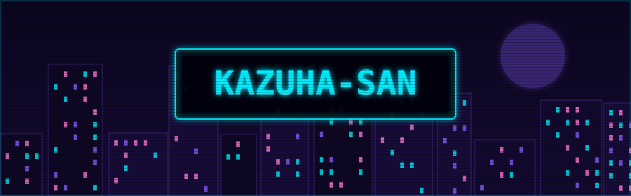

## Hello!

**I'm Sagar Shrivastava, a CS student from Bhopal, India.**

I love building things: full-stack products, AI-native products, tools, the occasional game. What I enjoy most is the whole journey, from digging into research and theorycrafting, through planning, to watching it actually come to life.

Right now I'm studying AI and ML and sharpening my skills across the board, from business thinking to hard engineering. I like solving problems, and I'm curious about almost everything: concepts, tools, even random facts.

Nice to meet you all!

[GitHub](https://github.com/Kazuha-san) · [LinkedIn](#) · [Email](#) · [Portfolio](#) · [X](#) · [Kaggle](#) · [LeetCode](#)

